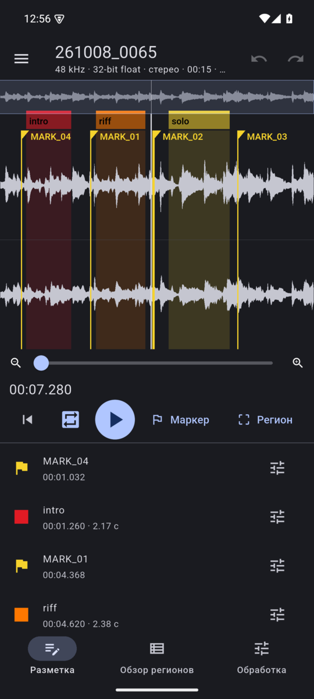
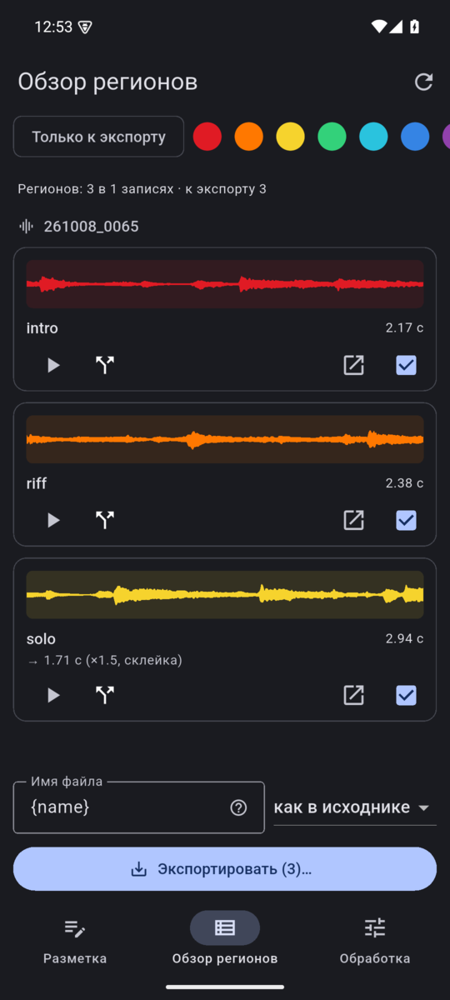
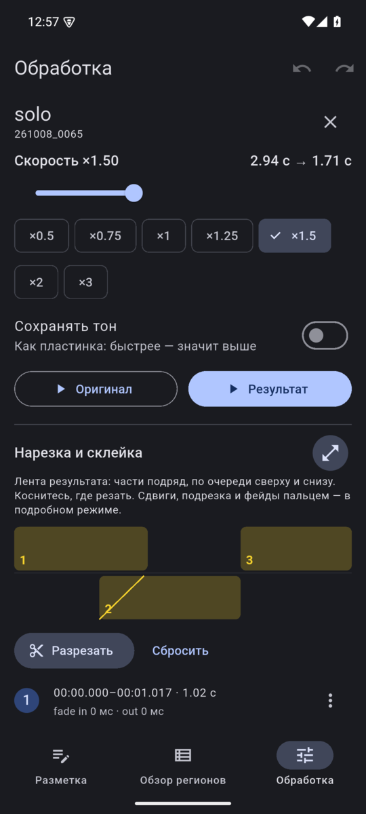
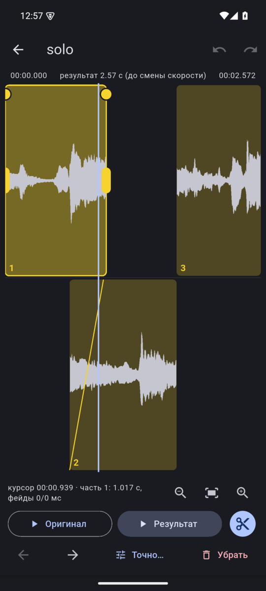
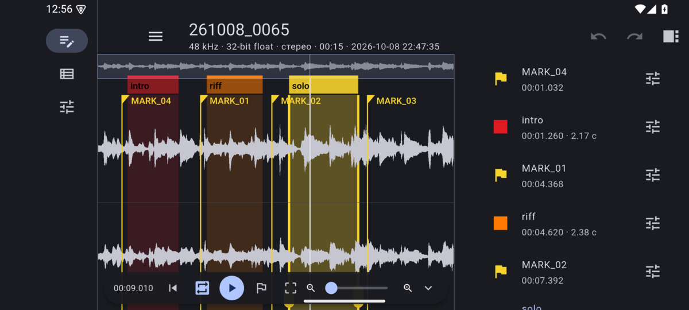

<p align="center">
  
</p>

<h1 align="center">Sample Creator</h1>

<p align="center">
  Разметка длинных записей с диктофона и нарезка из них сэмплов.<br>
  Linux (GTK4 / libadwaita) и Android.
</p>

<p align="center"><i>Mark up long field recordings and cut them into samples. Linux and Android. UI in Russian.</i></p>

---

Слушаешь запись, ставишь маркеры, выделяешь регионы, называешь их. Файлы
не появляются сразу: регионы остаются черновиками, пока ты не нажмёшь
«Экспортировать» и не выберешь папку. Исходные записи никогда не меняются,
и рядом с ними ничего не пишется — удобно, когда они лежат прямо на карте
рекордера.

Сделано для Tascam DR-40XP, но работает с любыми WAV/BWF (16/24/32 int, 32 float),
MP3 и FLAC. Записи на несколько часов — норма: всё читается потоково.

<p align="center">
  
  
  
  
</p>
<p align="center">
  
</p>

## Возможности

- **Разметка.** Волна по каналам, маркеры и регионы с именами и 8 цветами,
  undo/redo, автосохранение. Метки рекордера (`cue`) подхватываются сами,
  время начала берётся из `bext`.
- **Обзор регионов.** Все регионы всех записей с мини-волнами, прослушивание,
  фильтры по цвету, переход к месту в записи.
- **Экспорт** только по команде: шаблон имени, формат (как в исходнике, 24 бит,
  32 float), стерео целиком, один канал или L/R в отдельные файлы. В файл
  пишется `bext` со ссылкой на исходник.
- **Обработка региона.** Скорость ×0,25…×4 — как пластинка или с сохранением
  тона. Нарезка на части, перестановка, наложение частей и фейды, плавные
  переходы — на ленте результата.
- **Файл разметки на носителе** (по желанию): `sample-creator.json` на карте
  рекордера, чтобы разметка ездила между телефоном и компьютером.
- **Десктоп:** работа с клавиатуры (`?` — все клавиши), меню по правой кнопке.
- **Телефон:** жесты, горизонтальный режим, тема и цвета Material You,
  рекордер по USB OTG.

## Установка

**Android 8+** — APK в [релизах](../../releases) (arm64).

**Linux с Nix:**

```sh
nix run github:Horhik/sample-creator
```

Без Nix, а также сборка Android-версии — в [docs/BUILDING.md](docs/BUILDING.md).

## Как устроено

Rust: общий крейт [`engine`](engine) (чтение WAV/BWF/MP3/FLAC, волна, плеер на
cpal, SQLite, экспорт, обработка), десктоп на relm4 + libadwaita, телефон на
Flutter через flutter_rust_bridge ([`mobile`](mobile)). Подробный план и
решения — в [AGENTS.md](AGENTS.md).

## Лицензия

[MIT](LICENSE)
